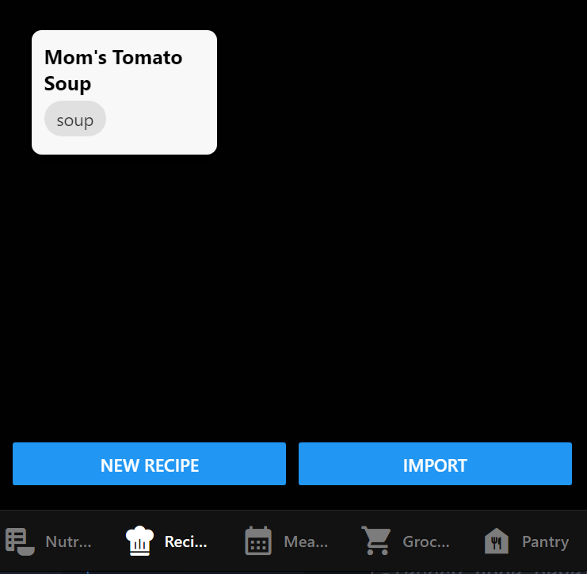
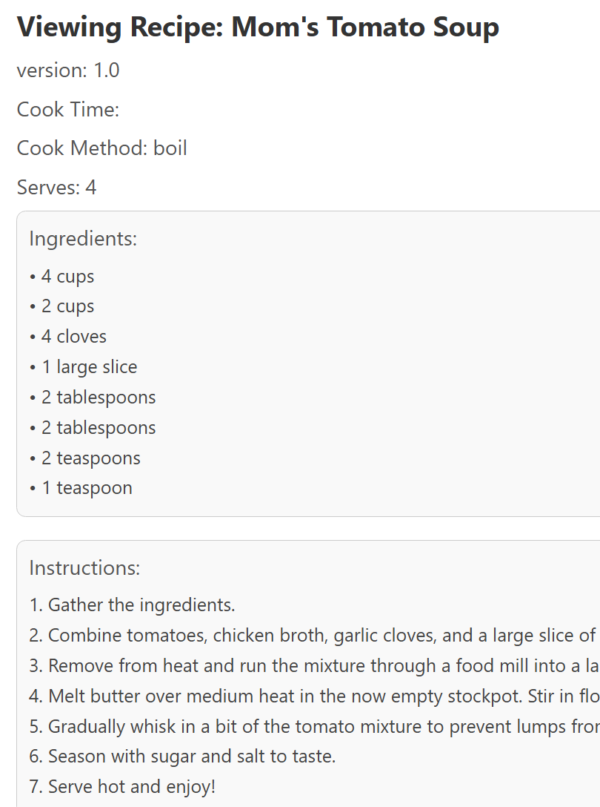

# Fill My Fridge

Recipe storage, shopping, and meal planning app aimed to optimise users' lives

## Authors

- Ana Knutson
- Billy York
- David Litton
- Yuliya Kazadoi

## Deployment

Must have [nodejs >= v20.16.0](https://nodejs.org/en) installed. Confirm both npm and npx are installed and on the path by running `npm -v` and `npx -v` respectivly. Then from the root of the repository run:

```bash
  npm run setup-and-start
```

or

```bash
   npm run web
```

To not run `npm install` each time.

## Usage/Examples

The prototype only implements adding new recipes and viewing recipes you have previously saved.

The app should open to the browser. A recipe or two should be shown by default shown below:



If you click on a recipe preview card you will be able to see the full recipe. Shown below:



If instead you click on the NEW RECIPE button located on the bottom left you will see the default recipe form.

Filling out the form requires a unique name, ingrediant(s), and instruction(s). After that clicking save will save the recipe and you may return to the previous screen. Now you should be able to see your new recipe among the other recipes.

## Dev Notes

For this dev release a database/local storage has not been implemented. We are instead using browser local storage. Aditional notes, the import button is not implemented.
